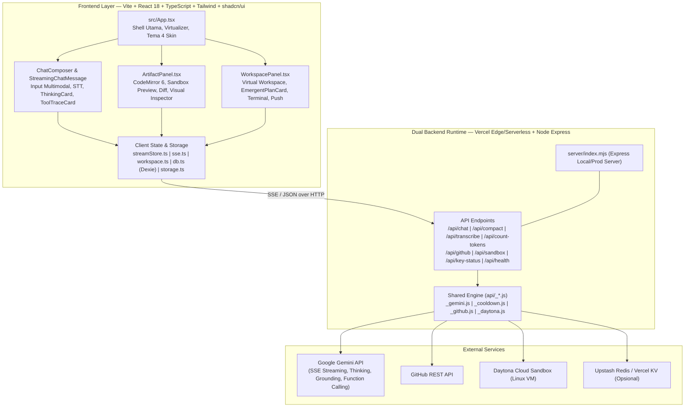

# Adam Studio — Gemini AI & Emergent Autonomous Workspace

**Adam Studio** adalah platform workspace AI multimodal dan *autonomous app builder* berbasis **React 18 + TypeScript + Vite + Tailwind CSS + shadcn/ui** dengan engine **Server-Sent Events (SSE)** berlatensi rendah. Proyek ini menggabungkan antarmuka chat AI modern, **Artifact Studio IDE**, **Emergent E1 Multi-File Workspace**, **GitHub Project Connector & Smart Push**, serta **Daytona Cloud Sandbox** dalam satu aplikasi PWA (*Progressive Web App*) yang siap dijalankan secara lokal maupun di-deploy ke **Vercel Edge + Serverless**.

---

## Daftar Isi

- [Fitur Utama](#fitur-utama)
- [Arsitektur Sistem & Alur Data](#arsitektur-sistem--alur-data)
- [Tech Stack](#tech-stack)
- [Struktur Direktori & Modul](#struktur-direktori--modul)
- [Referensi API Endpoints](#referensi-api-endpoints)
- [Konfigurasi Environment Variables](#konfigurasi-environment-variables)
- [Instalasi & Menjalankan Secara Lokal](#instalasi--menjalankan-secara-lokal)
- [Deployment (Vercel & VPS/Node.js)](#deployment-vercel--vpsnodejs)
- [Persona, Slash Commands & Keyboard Shortcuts](#persona-slash-commands--keyboard-shortcuts)
- [Penyimpanan Data & Keamanan](#penyimpanan-data--keamanan)

---

## Fitur Utama

### 1. Real-Time SSE Chat & Reasoning Engine
- **Zero-Lag Isolated Streaming (`src/lib/streamStore.ts`)**: Menggunakan `useSyncExternalStore` untuk mengisolasi pembaruan token SSE hanya pada komponen pesan yang sedang aktif *streaming* (`StreamingChatMessage.tsx`), menjaga daftar chat panjang tetap berjalan di 60fps dengan virtualisasi `@tanstack/react-virtual`.
- **Thinking & Reasoning Control (`ThinkingCard.tsx`)**: Mendukung konfigurasi `thinkingLevel` (`off`, `minimal`, `low`, `medium`, `high`) yang tervalidasi otomatis per keluarga model (`src/lib/models.ts`).
- **Multi-Key Pool Rotation & Cooldown (`api/_gemini.js`, `api/_cooldown.js`)**: Mendukung banyak Gemini API Key sekaligus (dipisahkan baris/koma/titik koma) dengan rotasi *round-robin*, *rate-limit cooldown* otomatis (429/401/403), *auto-fallback model* saat overload, serta sinkronisasi cooldown lintas-instance via **Upstash Redis / Vercel KV**.
- **Grounding & Multimodal**: Mendukung **Google Search Grounding**, **URL Context**, serta lampiran gambar, video, audio, PDF, dan file teks/kode dengan estimasi maupun penghitungan token akurat (`/api/count-tokens`).
- **Payload Guard Otomatis (`src/lib/sse.ts`)**: Secara adaptif memangkas lampiran lama dan konten historis agar payload permintaan selalu berada di bawah batas 4.5 MB Vercel (`MAX_VERCEL_SAFE_BYTES = 4_000_000`).

### 2. Emergent E1 — Autonomous App Builder & Virtual Workspace
- **Siklus Kerja Terstruktur (`EmergentPlanCard.tsx`, `WorkspacePanel.tsx`)**:
  1. **Discovery & Clarification (`emergent_ask_clarification`)**: Kartu pertanyaan interaktif (pilihan tunggal, multi-pilih, input kustom, dan rekomendasi AI) sebelum membangun aplikasi baru.
  2. **Blueprint Planning (`emergent_set_plan`, `emergent_update_task`)**: Rencana arsitektur beserta daftar task yang ter-update secara *real-time*.
  3. **Multi-File Virtual Workspace (`src/lib/workspace.ts`)**: File explorer, editor kode CodeMirror 6, pembuatan/patch/penghapusan file (`workspace_write_file`, `workspace_patch_file`, `workspace_delete_file`), serta verifikasi proyek (`workspace_verify_project`).
- **In-Browser React/TSX & HTML Compiler**: Mengompilasi modul React/TSX/Tailwind/Lucide langsung di browser menggunakan Babel Standalone + Tailwind CDN untuk preview instan tanpa build server, lengkap dengan tangkapan error ke AI (*self-healing*).
- **Export ZIP Runnable (`buildProjectZipBlob`)**: Mengemas proyek di workspace beserta file scaffold (`package.json`, `vite.config.ts`, `tailwind.config.js`, `tsconfig.json`, `index.html`, `src/main.tsx`, `README.md`) menjadi arsip `.zip` siap `npm install && npm run dev`.

### 3. Daytona Cloud Sandbox Integration (`api/_daytona.js`, `api/sandbox.js`)
- Menjalankan VM Linux Cloud nyata langsung dari **Workspace Terminal** maupun secara otonom oleh AI melalui tool `sandbox_run_command`, `sandbox_start_preview`, dan `sandbox_clone_github`.
- Mendukung sinkronisasi file workspace ke `$HOME/adam-app`, eksekusi perintah shell (`npm install`, `npx tsc --noEmit`, `npm run build`), *auto-clone* repository GitHub ke VM, manajemen *lifecycle* sandbox (`status`, `stop`, `delete`, `cleanup-sandboxes`), serta penyediaan **Live Preview URL** dev server Vite/Next.js.

### 4. Artifact Studio IDE & Visual Inspector (`src/components/ArtifactPanel.tsx`)
- Mengekstrak blok kode (`html`, `svg`, `mermaid`, `markdown`, dan modul kode >= 8 baris) serta otomatis membundel blok `html` + `css` + `js` menjadi aplikasi web pratinjau utuh (`src/lib/artifacts.ts`).
- **5 Mode Tampilan**: **Preview** (dengan *Device Frame Switcher* Mobile/Tablet/Desktop, zoom, dan `localStorage` shim aman), **Code** (CodeMirror 6), **Split**, **Diff** (perbandingan baris antar versi via `src/lib/diff.ts`), dan **Console** (menangkap `console.log/warn/error` serta runtime error dari `iframe`).
- **Visual Inspector**: Mode bidik elemen DOM di dalam `iframe` preview untuk mengirim selector dan cuplikan `outerHTML` sebagai `VisualTarget` ke Chat Composer agar AI memodifikasi elemen tersebut secara presisi.
- **Mermaid & KaTeX**: Render diagram arsitektur (`MermaidBlock.tsx`) dan formula matematika LaTeX (`rehype-katex` + `remark-math`).

### 5. GitHub Project Connector & Smart Git Push (`api/_github.js`)
- **Attach Repository (`GitHubConnectorDialog.tsx`)**: Menghubungkan repository publik maupun privat (via PAT) ke sesi chat sebagai konteks AI, lengkap dengan daftar file tree, penyematan file prioritas (*pinned files*), sinkronisasi commit terbaru (`sync-project`), dan agentic tools (`github_list_files`, `github_read_file`, `github_search_code`).
- **Smart Workspace Push (`GitHubPushDialog.tsx`)**: Menghitung diff SHA-1 Git blob secara akurat terhadap branch target (`preview-workspace-diff`), membuat branch baru bila belum ada, hanya mengunggah file yang berubah, serta menyediakan **AI Commit Message Generator** (`src/lib/commitGenerator.ts`) bergaya *Short* atau *Detail* (Conventional Commits).

### 6. Context Management, Import/Export & Produktivitas
- **Lossless Context Compactor (`ContextManagerDialog.tsx`, `api/compact.js`)**: Dua strategi penghematan token — *Keep Latest Code* (meringkas blok kode lama dan mempertahankan versi terbaru) serta *AI Summary* (merangkum histori lama secara bertahap lewat SSE tanpa menghilangkan detail teknis).
- **Universal Chat Importer (`ImportChatDialog.tsx`, `src/lib/importer.ts`)**: Mendukung impor histori dari **Google AI Studio (Drive JSON)**, **ChatGPT Export JSON**, **Adam Studio JSON**, array pesan generik, maupun dokumen **Markdown (`.md`)**.
- **Voice Input (STT) & Read Aloud (TTS) (`src/lib/speech.ts`)**: Perekam audio WAV 16kHz dengan transkripsi AI (`/api/transcribe`) atau Web Speech API browser + normalisasi istilah teknis, serta fitur *Read Aloud* (TTS) berantrean chunk dengan deteksi bahasa otomatis (`id-ID` / `en-US`).
- **AI Prompt Enhancer (`src/lib/promptEnhancer.ts`)**: Menyempurnakan draf prompt pengguna langsung di composer.
- **4 Theme Skins + PWA**: Pilihan skin **Obsidian Pro**, **Claude Dusk**, **Cyber Aurora**, dan **Paper Editorial** (`src/index.css`), mode kepadatan UI (*comfortable* / *compact*), Zen Focus Mode, Starred Bookmarks, Fork Thread, Edit & Resend, serta dukungan instalasi **PWA** (`vite-plugin-pwa`).

---

## Arsitektur Sistem & Alur Data

### Diagram Arsitektur



### Alur Eksekusi Request & Agentic Loop

1. **Perakitan Konteks di Browser**: `src/App.tsx` menyusun histori efektif melalui `buildEffectiveApiHistory()`, melampirkan snapshot `VirtualWorkspace` (jika di *Emergent Mode*) atau metadata `GitHubProjectContext`, lalu mengirimkannya lewat `streamChatCompletion()` di `src/lib/sse.ts`.
2. **Pemilihan Key & Fallback (`api/_gemini.js`)**: Server menggabungkan API key dari header request (`x-gemini-api-key`) atau environment server, menghidrasi status cooldown dari memori / Upstash Redis (`api/_cooldown.js`), lalu melakukan rotasi *round-robin*.
3. **Agentic Tool Loop**: Jika model memanggil *function declarations* (`github_*`, `emergent_*`, `workspace_*`, atau `sandbox_*`), backend mengeksekusi tool tersebut, mengirimkan event SSE real-time (`tool_call`, `tool_result`, `workspace_plan`, `workspace_clarification`, `workspace_file`, `workspace_sandbox`) ke browser, lalu mengembalikan hasilnya ke Gemini hingga jawaban final selesai.
4. **Update UI 60fps & Persistensi**: Token masuk memperbarui `streamStore.ts` secara terisolasi. Setelah event `done`, pesan difinalisasi ke state percakapan, disimpan secara inkremental ke **IndexedDB (Dexie)** (`src/lib/db.ts`), dan blok artifact diekstrak otomatis.

---

## Tech Stack

| Lapisan | Teknologi |
| :--- | :--- |
| **Frontend Core** | React 18.3, TypeScript 5.7, Vite 6.0, PWA (`vite-plugin-pwa`, Workbox) |
| **UI & Styling** | Tailwind CSS 3.4, `tailwindcss-animate`, Radix UI / shadcn/ui, Framer Motion 11, Lucide React |
| **Editor & Visualisasi** | CodeMirror 6 (`@uiw/react-codemirror`), Mermaid 11, KaTeX, Highlight.js, `react-markdown`, `remark-gfm`, `remark-math`, `rehype-katex` |
| **Performa & UX** | `@tanstack/react-virtual`, `overlayscrollbars-react`, `cmdk`, `sonner` |
| **Client Storage** | Dexie 4 (IndexedDB) + `localStorage` |
| **Backend Runtime** | Vercel Edge Functions (`api/*.js`), Vercel Node Serverless (`api/sandbox.js`), Express 4 (`server/index.mjs`) |
| **Integrasi Eksternal** | Google Gemini API (`v1beta`), GitHub REST API (`2022-11-28`), Daytona Cloud API, Upstash Redis REST API |

---

## Struktur Direktori & Modul

```text
Adam-studio/
├── api/                          # Endpoint Vercel Edge/Serverless & shared backend modules
│   ├── _cooldown.js              # Rate-limit cooldown manager (Memory + Upstash Redis/KV)
│   ├── _daytona.js               # Klien Daytona Cloud Sandbox (VM lifecycle, sync, exec, clone, preview)
│   ├── _gemini.js                # Orkestrator Gemini SSE, multi-key rotation, Emergent & tool loop
│   ├── _github.js                # GitHub REST API client, repo tree/read/search, SHA-1 diff & push
│   ├── chat.js                   # Edge endpoint POST /api/chat (SSE streaming + Demo mode)
│   ├── compact.js                # Edge endpoint POST /api/compact (Lossless AI context compactor)
│   ├── count-tokens.js           # Edge endpoint POST /api/count-tokens (hitung token lampiran)
│   ├── github.js                 # Edge endpoint POST /api/github (aksi GitHub connector & push)
│   ├── health.js                 # Edge endpoint GET /api/health (status konfigurasi server)
│   ├── key-status.js             # Edge endpoint GET/POST /api/key-status (status cooldown key pool)
│   ├── sandbox.js                # Node Serverless endpoint POST /api/sandbox (maxDuration: 60s)
│   └── transcribe.js             # Edge endpoint POST /api/transcribe (AI Speech-to-Text SSE)
├── server/
│   └── index.mjs                 # Express server untuk dev lokal & deployment Node.js produksi
├── public/
│   └── favicon.svg               # Ikon vektor aplikasi
├── src/
│   ├── components/
│   │   ├── ui/                   # Komponen primitif shadcn/ui & StudioScroll (OverlayScrollbars)
│   │   ├── ArtifactPanel.tsx     # Studio IDE: Preview, CodeMirror, Split, Diff, Console & Visual Inspector
│   │   ├── BookmarksDialog.tsx   # Pengelola pesan yang ditandai bintang (Starred Bookmarks)
│   │   ├── BrandLogo.tsx         # Komponen logo Adam Studio
│   │   ├── ChatComposer.tsx      # Input multimodal, slash commands, STT mic, prompt enhancer, visual target
│   │   ├── ChatMessage.tsx       # Render pesan statis, aksi copy/edit/fork/TTS/star
│   │   ├── CodeMirrorEditor.tsx  # Wrapper lazy-loaded CodeMirror 6 (One Dark theme)
│   │   ├── CommandPalette.tsx    # Command Palette & full-text search (Ctrl+K)
│   │   ├── ContextManagerDialog.tsx # UI manajemen token & AI context compaction
│   │   ├── EmergentPlanCard.tsx  # Kartu blueprint rencana & progress task Emergent E1
│   │   ├── GitHubConnectorDialog.tsx # Dialog penghubung repo GitHub & pinned files
│   │   ├── GitHubPushDialog.tsx  # Dialog preview diff, AI commit generator & push ke GitHub
│   │   ├── ImportChatDialog.tsx  # Dialog impor chat AI Studio / ChatGPT / JSON / Markdown
│   │   ├── InstallAppDialog.tsx  # Panduan & prompt instalasi PWA
│   │   ├── MarkdownRenderer.tsx  # Renderer Markdown + GFM + KaTeX + Highlight + Mermaid + Artifact trigger
│   │   ├── MermaidBlock.tsx      # Renderer interaktif diagram Mermaid
│   │   ├── ModelSelectorDialog.tsx # Pemilih model preset & custom model ID
│   │   ├── SelectionQuotePopover.tsx # Popover kutip teks pilihan dari balasan AI
│   │   ├── SettingsDialog.tsx    # Pengaturan koneksi API, parameter model, persona, skin, & backup DB
│   │   ├── ShortcutsDialog.tsx   # Daftar shortcut keyboard & gesture mobile
│   │   ├── Sidebar.tsx           # Drawer riwayat sesi, pin, pencarian, mode chat/emergent
│   │   ├── StreamingChatMessage.tsx # Wrapper pesan aktif terhubung ke streamStore.ts
│   │   ├── ThinkingCard.tsx      # Accordion proses berpikir/reasoning model
│   │   ├── ToolTraceCard.tsx     # Jejak visual pemanggilan tool (GitHub, Workspace, Daytona)
│   │   └── WorkspacePanel.tsx    # IDE Emergent multi-file, Preview browser/Daytona, Terminal & ZIP export
│   ├── hooks/
│   │   └── usePwaInstall.ts      # Hook beforeinstallprompt & deteksi mode standalone PWA
│   ├── lib/
│   │   ├── artifacts.ts          # Ekstraktor blok kode & generator srcdoc dengan sandbox bridge
│   │   ├── commitGenerator.ts    # Generator pesan commit Conventional Commits berbasis AI/lokal
│   │   ├── db.ts                 # Database Dexie (IndexedDB), migrasi v1->IDB, backup & restore JSON
│   │   ├── diff.ts               # Algoritma LCS line-by-line diff
│   │   ├── importer.ts           # Parser multi-format impor chat & logika context compaction
│   │   ├── models.ts             # Definisi model, kalkulator biaya & deteksi kapabilitas thinking
│   │   ├── personas.ts           # Preset persona AI & template slash commands
│   │   ├── promptEnhancer.ts     # AI prompt refiner & fallback lokal
│   │   ├── sound.ts              # Efek suara notifikasi selesai via Web Audio API
│   │   ├── speech.ts             # Perekam WAV 16kHz, STT AI SSE client & TTS chunked queue
│   │   ├── sse.ts                # Klien streaming SSE POST /api/chat & payload size guard
│   │   ├── storage.ts            # Helper localStorage untuk settings & fallback histori
│   │   ├── streamStore.ts        # External store terisolasi untuk streaming state 60fps
│   │   ├── tokens.ts             # Helper penghitungan token lampiran
│   │   ├── utils.ts              # Utilitas cn(), estimasi token, format bytes, clipboard
│   │   └── workspace.ts          # Virtual FS, compiler Babel/React in-browser, scaffold & ZIP builder
│   ├── types/
│   │   └── chat.ts               # Definisi tipe TypeScript seluruh entitas aplikasi
│   ├── App.tsx                   # Komponen root aplikasi & orkestrator state utama
│   ├── index.css                 # Definisi 4 theme skins CSS variables & custom OverlayScrollbars
│   └── main.tsx                  # Entry point React DOM
├── .env.example                  # Template variabel lingkungan
├── index.html                    # Entry HTML + pre-hydration skin script
├── package.json                  # Dependensi & skrip build/dev
├── setup.mjs                     # Utilitas unpack Bundle.txt
├── tailwind.config.js            # Konfigurasi Tailwind CSS
├── tsconfig.json                 # Konfigurasi TypeScript
├── vercel.json                   # Konfigurasi build, rewrites SPA & timeout /api/sandbox
└── vite.config.ts                # Konfigurasi Vite, alias `@/`, proxy `/api`, & VitePWA
```

---

## Referensi API Endpoints

Semua endpoint tersedia baik di **Vercel (`api/*.js`)** maupun di **Express Server lokal (`server/index.mjs`)**.

| Method & Path | Runtime | Fungsi Utama | Header Autentikasi Opsional |
| :--- | :--- | :--- | :--- |
| `POST /api/chat` | Edge | Streaming SSE chat, reasoning, grounding, & agentic tool loop (GitHub, Emergent, Daytona) | `x-gemini-api-key`, `x-github-token`, `x-daytona-api-key`, `x-daytona-api-url` |
| `POST /api/compact` | Edge | Streaming SSE ringkasan histori panjang (*Lossless Context Compaction*) | `x-gemini-api-key` |
| `POST /api/transcribe` | Edge | Streaming SSE transkripsi audio WAV 16kHz melalui Gemini | `x-gemini-api-key` |
| `POST /api/count-tokens` | Edge | Menghitung jumlah token akurat untuk lampiran teks/biner | `x-gemini-api-key` |
| `POST /api/github` | Edge | Aksi `list-repos`, `get-repo-tree`, `clone-to-workspace`, `read-files`, `sync-project`, `preview-workspace-diff`, `push-workspace` | `x-github-token` |
| `POST /api/sandbox` | Node (60s) | Aksi Daytona Cloud: `status`, `clone-github`, `deploy-preview`, `exec`, `stop`, `delete`, `cleanup-sandboxes` | `x-daytona-api-key`, `x-daytona-api-url`, `x-github-token` |
| `GET/POST /api/key-status` | Edge | Mengecek daftar API key aktif, sumber (`browser`/`server`), & sisa waktu cooldown | `x-gemini-api-key` |
| `GET /api/health` | Edge | Mengecek status server, model default, ketersediaan server key, & `DEMO_MODE` | — |

---

## Konfigurasi Environment Variables

Salin `.env.example` menjadi `.env` untuk penggunaan lokal, atau atur melalui **Project Settings → Environment Variables** di Vercel:

```env
# API Key Google Gemini (opsional jika pengguna mengisi key sendiri di Settings UI)
GEMINI_API_KEY=
# Opsional: banyak key sekaligus (dipisahkan koma/baris baru) untuk rotasi otomatis
GEMINI_API_KEYS=

# Model default saat sesi baru dibuat
DEFAULT_MODEL=gemini-4-hydrogen

# Port Express backend server lokal (default: 3001)
PORT=3001

# Set true untuk mengaktifkan simulasi SSE lokal bila belum ada API key
DEMO_MODE=false

# Opsional: GitHub Personal Access Token default di sisi server
GITHUB_TOKEN=

# Opsional: Upstash Redis / Vercel KV untuk sinkronisasi cooldown API Key di Vercel Edge
UPSTASH_REDIS_REST_URL=
UPSTASH_REDIS_REST_TOKEN=

# Opsional: Daytona Cloud Sandbox untuk real npm install, terminal Linux & Vite live preview
DAYTONA_API_KEY=
DAYTONA_API_URL=https://app.daytona.io/api
```

> **Catatan:** Pengguna juga dapat memasukkan **Gemini API Key Pool**, **GitHub PAT**, dan **Daytona API Key** langsung dari browser melalui menu **Settings → Koneksi**. Key dari browser dikirim melalui header HTTPS ke endpoint API dan tidak disimpan di database server.

---

## Instalasi & Menjalankan Secara Lokal

### Prasyarat
- **Node.js** `>= 18` (disarankan v20+)
- **pnpm** (direkomendasikan sesuai `package.json` & `vercel.json`)

### Langkah Menjalankan

1. **Clone repository & instal dependensi:**
   ```bash
   git clone https://github.com/AdamOfficialDev/Adam-studio.git
   cd Adam-studio
   pnpm install
   ```

2. **Siapkan file environment (opsional):**
   ```bash
   cp .env.example .env
   ```
   Isi `GEMINI_API_KEY` di `.env` atau biarkan kosong untuk mengisinya nanti melalui UI **Settings**.

3. **Jalankan mode development (Server API + Vite Client secara paralel):**
   ```bash
   pnpm dev
   ```
   - Frontend Vite berjalan di `http://localhost:5173`
   - Backend Express SSE berjalan di `http://localhost:3001` (otomatis di-proxy oleh Vite untuk rute `/api/*`)

4. **Build & uji mode produksi lokal:**
   ```bash
   pnpm build
   pnpm start
   ```

---

## Deployment (Vercel & VPS/Node.js)

### Deploy ke Vercel (Direkomendasikan)
Repository sudah dilengkapi `vercel.json` dengan konfigurasi siap pakai:
- **Install Command**: `pnpm install --no-frozen-lockfile`
- **Build Command**: `pnpm build` (`tsc --noEmit && vite build`)
- **Output Directory**: `dist`
- **SPA Routing**: Semua rute non-`/api/*` diarahkan ke `/index.html`
- **Timeout Sandbox**: `api/sandbox.js` dikonfigurasi dengan `maxDuration: 60` detik.

Cukup hubungkan repository ke Vercel, tambahkan Environment Variables yang diperlukan (opsional), lalu deploy.

### Deploy ke VPS / Node.js Server
Jalankan `pnpm build` lalu jalankan `pnpm start` (`NODE_ENV=production node server/index.mjs`). Express server pada `server/index.mjs` akan menyajikan API endpoints sekaligus static assets hasil build Vite di folder `dist/`.

---

## Persona, Slash Commands & Keyboard Shortcuts

### Preset Persona AI (`src/lib/personas.ts`)
| Persona | Fokus Utama | Rekomendasi Thinking |
| :--- | :--- | :--- |
| **Emergent E1** | Product Architect & Autonomous Builder (`Clarify → Plan → Build → Verify`) | `high` |
| **Adam Studio Pro** | Asisten serbaguna untuk coding, arsitektur, Mermaid & UI | `medium` |
| **Principal Engineer** | Kode TypeScript produksi, edge-case, concurrency & zero-bug | `high` |
| **UI/UX Craftsman** | Layout flagship, micro-interaction & prototipe HTML mandiri | `medium` |
| **Executive Brief** | Jawaban ringkas, padat & langsung poin aksi | `low` |

### Slash Commands (`/` di Chat Composer)
- `/build` — Bangun aplikasi multi-file lengkap dengan alur Emergent
- `/ui` — Buat prototipe UI interaktif mandiri dalam satu blok HTML
- `/diagram` — Visualisasikan arsitektur atau sequence diagram Mermaid
- `/review` — Audit kode mendalam (bug, keamanan, kompleksitas, memory leak)
- `/architect` — Rancang arsitektur sistem scalable lengkap dengan diagram
- `/refactor` — Refactor kode menjadi modular dan strictly typed
- `/sql` — Optimasi query SQL dan strategi indexing

### Keyboard Shortcuts & Gesture
| Pintasan | Aksi |
| :--- | :--- |
| `Ctrl + K` (`⌘ + K`) | Buka Command Palette & pencarian teks penuh |
| `Ctrl + B` (`⌘ + B`) | Toggle Sidebar / Icon Rail |
| `Ctrl + \` (`⌘ + \`) | Toggle Zen Focus Mode |
| `?` | Buka dialog daftar Keyboard Shortcuts |
| `/` | Buka menu Slash Prompt Templates di composer |
| `Enter` / `Shift + Enter` | Kirim pesan / Tambah baris baru |
| `↑` / `↓` | Navigasi Slash Templates atau Command Palette |
| **Swipe Kiri (Mobile)** | Menutup drawer sidebar riwayat percakapan |

---

## Penyimpanan Data & Keamanan

- **IndexedDB via Dexie (`adam-studio-db`)**: Seluruh riwayat percakapan, lampiran, dan state `VirtualWorkspace` disimpan di IndexedDB dengan sinkronisasi inkremental dan migrasi otomatis dari penyimpanan `localStorage` versi lama (`hydrogen-chat-conversations-v1/v2/v3`).
- **Backup & Restore JSON**: Pengguna dapat mengekspor seluruh percakapan menjadi satu file `.json` dan memulihkannya kapan saja melalui **Settings → Memori & Data**.
- **Sanitasi Sandbox & Output**: Preview Artifact berjalan di dalam `iframe` terisolasi lengkap dengan *in-memory shim* untuk `localStorage`/`sessionStorage`, sedangkan output terminal Daytona disanitasi dari kebocoran token GitHub (`sanitizeSecretOutput`).
