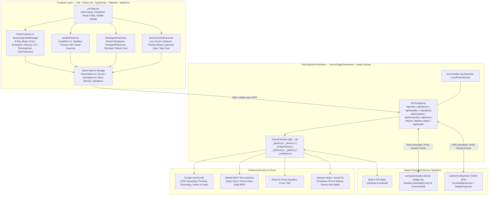
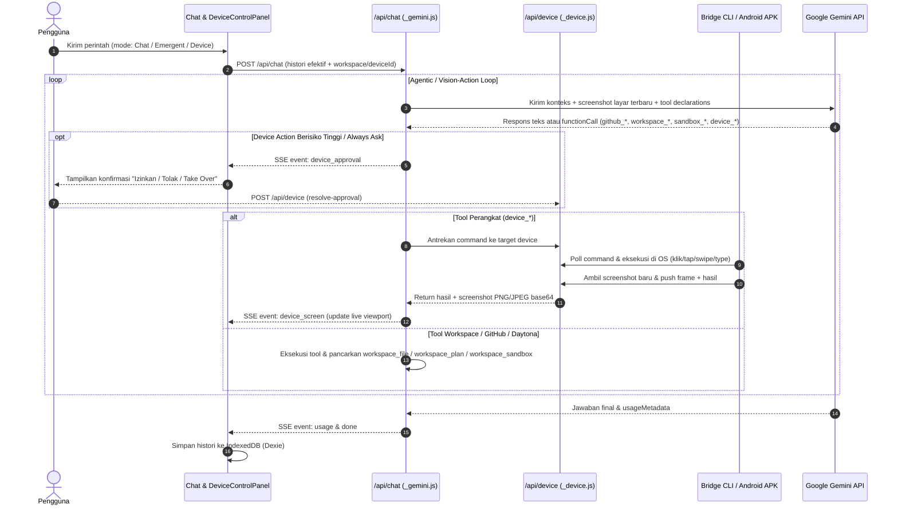

<div align="center">

# ⚡ Adam Studio

**AI Workspace Multimodal, Autonomous App Builder, & Cross-Device Operator**

[](https://react.dev)
[](https://www.typescriptlang.org)
[](https://vitejs.dev)
[](https://tailwindcss.com)
[](#3-device-control-center--operator-desktop--android)
[](#deployment-vercel--nodejs)

*Satu workspace serbaguna untuk ngobrol dengan AI berlatensi rendah, merancang & merender UI interaktif secara instan, membangun aplikasi multi-file otonom, menjalankan terminal Linux cloud, hingga mengendalikan Desktop & HP Android secara langsung.*

[Fitur Unggulan](#-fitur-unggulan) • [Arsitektur Sistem](#-arsitektur-sistem) • [Device Control & APK](#-panduan-device-control-desktop--android) • [API Endpoints](#-referensi-api-endpoints) • [Instalasi Lokal](#-instalasi--menjalankan-secara-lokal)

</div>

---

## Kenapa Adam Studio?

Kebanyakan antarmuka AI hanya berhenti di kotak chat teks. **Adam Studio** menggabungkan **AI Reasoning Engine**, **Live IDE**, **Cloud Sandbox**, dan **Device Operator** dalam satu pengalaman PWA (*Progressive Web App*) yang ringan dan responsif—nyaman dipakai dari browser desktop hingga layar smartphone (*mobile-first*).

- 🧠 **Streaming 60fps tanpa lag** bahkan pada ribuan token dan riwayat percakapan panjang.
- 🛠️ **Dari ide ke aplikasi utuh** lewat mode **Emergent E1** (tanya klarifikasi → blueprint plan → multi-file code → live preview & ZIP export).
- 📱 **AI yang punya "mata & tangan"** untuk melihat layar dan mengoperasikan **Desktop (Windows/macOS/Linux)** maupun **HP Android** lewat Bridge CLI atau **Android Companion APK** native.
- 🔄 **Terintegrasi penuh ke GitHub & Daytona Cloud**, lengkap dengan diff SHA-1 otomatis, AI commit generator, dan cloud VM Linux nyata.

---

## ✨ Fitur Unggulan

### 1. Real-Time SSE Chat & Reasoning Engine
- **Zero-Lag Isolated Streaming (`src/lib/streamStore.ts`)**: Memanfaatkan `useSyncExternalStore` untuk mengisolasi pembaruan token SSE hanya pada pesan yang aktif *streaming* (`StreamingChatMessage.tsx`), menjaga scroll daftar chat panjang tetap mulus 60fps via `@tanstack/react-virtual`.
- **Thinking & Reasoning Control (`ThinkingCard.tsx`)**: Kontrol kedalaman berpikir model (`off`, `minimal`, `low`, `medium`, `high`) yang tervalidasi otomatis per keluarga model (`src/lib/models.ts`).
- **Multi-Key Pool Rotation & Cooldown (`api/_gemini.js`, `api/_cooldown.js`)**: Mendukung banyak Gemini API Key sekaligus dengan rotasi *round-robin*, *rate-limit cooldown* otomatis (429/401/403), *auto-fallback model*, serta sinkronisasi cooldown lintas-instance via **Upstash Redis / Vercel KV**.
- **Grounding, Multimodal & Payload Guard (`src/lib/sse.ts`)**: Mendukung **Google Search Grounding**, **URL Context**, lampiran gambar/video/audio/PDF/kode, penghitung token akurat (`/api/count-tokens`), serta pemangkasan payload adaptif agar selalu aman di bawah batas `4.5 MB` Vercel (`MAX_VERCEL_SAFE_BYTES = 4_000_000`).

### 2. Emergent E1 — Autonomous App Builder & Virtual Workspace
- **Siklus Kerja Terstruktur (`EmergentPlanCard.tsx`, `WorkspacePanel.tsx`)**:
  1. **Discovery & Clarification (`emergent_ask_clarification`)**: Kartu brief interaktif (pilihan tunggal, multi-pilih, input kustom, dan rekomendasi arsitektur AI) sebelum membangun proyek baru.
  2. **Blueprint Planning (`emergent_set_plan`, `emergent_update_task`)**: Rencana arsitektur dan status task yang bergerak real-time.
  3. **Multi-File Virtual Workspace (`src/lib/workspace.ts`)**: File explorer, editor CodeMirror 6, edit/patch modular (`workspace_write_file`, `workspace_patch_file`, `workspace_delete_file`), dan verifikasi sintaks/import (`workspace_verify_project`).
- **In-Browser React/TSX & HTML Compiler**: Mengompilasi komponen React/TSX, Tailwind CSS, dan Lucide Icons langsung di browser lewat Babel Standalone untuk preview instan tanpa menunggu build server.
- **Export ZIP Runnable (`buildProjectZipBlob`)**: Mengemas proyek workspace lengkap dengan file scaffold (`package.json`, `vite.config.ts`, `tailwind.config.js`, `tsconfig.json`, `index.html`, `src/main.tsx`, `README.md`) menjadi arsip `.zip` siap `npm install && npm run dev`.

### 3. Device Control Center & Operator (Desktop & Android)
Ubah mode composer ke **Device** untuk memberi AI kemampuan melihat layar dan mengoperasikan perangkat secara langsung (*Vision-Action Loop* ala Claude Computer Use & ChatGPT Operator):
- **3 Jalur Perangkat (`DeviceControlPanel.tsx`, `api/_device.js`)**:
  1. **Built-in Virtual Simulator (Desktop & Android)**: Langsung uji coba alur *screenshot → tap/click → type → verify* di browser tanpa instalasi apa pun.
  2. **Companion Bridge CLI (`companion/adam-device-bridge.mjs`)**: Skrip Node.js ringan (dapat diunduh langsung dari `/api/device?action=bridge-script`) untuk mengendalikan **Desktop (Windows/macOS/Linux)** atau **HP Android via ADB (USB / Wireless Debugging)**.
  3. **Android Companion APK Native (`android-companion/`)**: Aplikasi Kotlin + Jetpack Compose bertema *Obsidian & Electric Indigo* yang berjalan mandiri langsung di HP Android tanpa PC dan tanpa ADB:
     - **`MediaProjection` + `ForegroundService` (`ScreenCaptureService.kt`)**: Tangkap layar HP secara background dengan kompresi adaptif.
     - **`AccessibilityService` (`AdamAccessibilityService.kt`)**: Eksekusi *tap, double tap, swipe, scroll, input text, Back/Home/Recents*, dan buka aplikasi secara native.
     - **Cloud Auto-Build via GitHub Actions (`.github/workflows/build-android-apk.yml`)**: Tidak perlu menginstal Android Studio atau Gradle di laptop—setiap push ke GitHub otomatis menghasilkan `adam-device-companion.apk` di **GitHub Releases (`android-companion-latest`)**.
- **Human-in-the-Loop Safety Gate & Kill Switch**:
  - 3 kebijakan keamanan: **High-Risk Ask** (konfirmasi untuk aksi berisiko seperti ketik password, transaksi, hapus, atau perintah terminal), **Always Ask**, dan **Autonomous**.
  - Tombol **Take Over Manual** kapan saja untuk menghentikan AI dan mengambil alih kontrol perangkat.
  - **Live Screen Viewport** menampilkan titik koordinat klik/tap AI secara real-time beserta *action timeline*.

### 4. Daytona Cloud Sandbox Integration (`api/_daytona.js`, `api/sandbox.js`)
- Menjalankan VM Linux Cloud nyata langsung dari **Workspace Terminal** maupun secara otonom oleh AI (`sandbox_run_command`, `sandbox_start_preview`, `sandbox_clone_github`).
- Sinkronisasi file workspace ke `$HOME/adam-app`, eksekusi perintah shell nyata (`npm install`, `npx tsc --noEmit`, `npm run build`), manajemen lifecycle sandbox (`status`, `stop`, `delete`, `cleanup-sandboxes`), serta penyediaan **Live Preview URL** server Vite/Next.js.

### 5. Artifact Studio IDE & Visual Inspector (`src/components/ArtifactPanel.tsx`)
- Mengekstrak blok kode (`html`, `svg`, `mermaid`, `markdown`, dan modul kode >= 8 baris) serta membundel `html` + `css` + `js` otomatis menjadi web app pratinjau utuh (`src/lib/artifacts.ts`).
- **5 Mode Tampilan**: **Preview** (Device Frame Switcher Mobile/Tablet/Desktop + `localStorage` shim aman), **Code** (CodeMirror 6), **Split**, **Diff** (`src/lib/diff.ts`), dan **Console** (log & runtime error iframe).
- **Visual Inspector**: Bidik elemen DOM langsung di dalam preview untuk mengirim selector dan potongan `outerHTML` sebagai `VisualTarget` ke Chat Composer agar AI memodifikasi elemen tersebut secara presisi.
- **Mermaid & KaTeX**: Render diagram arsitektur (`MermaidBlock.tsx`) dan persamaan matematika LaTeX.

### 6. GitHub Project Connector & Smart Git Push (`api/_github.js`)
- **Attach Repository (`GitHubConnectorDialog.tsx`)**: Menghubungkan repo publik/privat ke sesi chat sebagai konteks aktif, lengkap dengan tree browser, *pinned files*, sinkronisasi commit terbaru (`sync-project`), dan agentic tools (`github_list_files`, `github_read_file`, `github_search_code`).
- **Smart Workspace Push (`GitHubPushDialog.tsx`)**: Menghitung diff SHA-1 Git blob terhadap branch target (`preview-workspace-diff`), otomatis membuat branch baru jika belum ada, mendukung deteksi izin scope `workflow`, serta dilengkapi **AI Commit Message Generator** (`src/lib/commitGenerator.ts`).

### 7. Produktivitas, Voice & Mobile-First Experience
- **Lossless Context Compactor (`ContextManagerDialog.tsx`, `api/compact.js`)**: Meringkas riwayat lama via *Keep Latest Code* atau *AI Summary* agar sesi panjang tidak melebihi batas token.
- **Universal Chat Importer (`ImportChatDialog.tsx`, `src/lib/importer.ts`)**: Impor riwayat dari **Google AI Studio**, **ChatGPT Export**, **Adam Studio JSON**, maupun **Markdown (`.md`)**.
- **Voice Input (STT) & Read Aloud (TTS) (`src/lib/speech.ts`)**: Perekam audio WAV 16kHz + transkripsi AI (`/api/transcribe`) atau Web Speech API, serta *Read Aloud* multi-chunk (`id-ID` / `en-US`).
- **4 Theme Skins + Responsive Mobile UI**: Pilihan skin **Obsidian Pro**, **Claude Dusk**, **Cyber Aurora**, dan **Paper Editorial** (`src/index.css`), Zen Focus Mode, Bookmarks, Fork Thread, Command Palette (`Ctrl+K`), dan toolbar mobile 1 baris yang bersih serta lega.

---

## 🏗️ Arsitektur Sistem

### Diagram Arsitektur Menyeluruh



### Alur Kerja Agentic & Vision-Action Loop



---

## 🛠️ Tech Stack

| Lapisan | Teknologi |
| :--- | :--- |
| **Frontend Core** | React 18.3, TypeScript 5.7, Vite 6.0, PWA (`vite-plugin-pwa`, Workbox) |
| **UI & Styling** | Tailwind CSS 3.4, `tailwindcss-animate`, Radix UI / shadcn/ui, Framer Motion 11, Lucide React |
| **Editor & Visualisasi** | CodeMirror 6 (`@uiw/react-codemirror`), Mermaid 11, KaTeX, Highlight.js, `react-markdown`, `remark-gfm`, `remark-math` |
| **Performa & Storage** | `@tanstack/react-virtual`, `overlayscrollbars-react`, `cmdk`, `sonner`, Dexie 4 (IndexedDB), `localStorage` |
| **Backend Runtime** | Vercel Edge Functions (`api/*.js`), Vercel Node Serverless (`api/sandbox.js`), Express 4 (`server/index.mjs`) |
| **Device & Android** | Node.js Bridge CLI (`companion/adam-device-bridge.mjs`), Kotlin + Jetpack Compose + Material 3 + `AccessibilityService` + `MediaProjection` (`android-companion/`), GitHub Actions CI |
| **Integrasi Cloud** | Google Gemini API (`v1beta`), GitHub REST API, Daytona Cloud API, Upstash Redis REST API |

---

## 📁 Struktur Direktori & Modul

```text
Adam-studio/
├── .github/workflows/
│   └── build-android-apk.yml       # CI/CD GitHub Actions auto-compile APK & publish GitHub Release
├── android-companion/              # Project Android Companion native (Kotlin + Jetpack Compose)
│   └── app/src/main/java/com/adamstudio/companion/
│       ├── MainActivity.kt         # Entry activity, izin MediaProjection & notifikasi
│       ├── data/CompanionState.kt  # State reaktif pairing, izin, log aksi & SharedPreferences
│       ├── network/BridgeApiClient.kt # Klien HTTP ke /api/device (register, frame, poll, result)
│       ├── service/
│       │   ├── AdamAccessibilityService.kt # Eksekutor gesture (tap, swipe, type, back/home, launch)
│       │   └── ScreenCaptureService.kt     # ForegroundService + MediaProjection screenshot loop
│       └── ui/
│           ├── CompanionScreen.kt  # UI Material 3 Obsidian, checklist izin, paste config & log
│           └── theme/Theme.kt      # Palet warna & tipografi dark obsidian
├── companion/
│   └── adam-device-bridge.mjs      # Bridge CLI standalone (Desktop Win/Mac/Linux & Android ADB)
├── api/                            # Endpoint Vercel Edge/Serverless & shared backend modules
│   ├── _bridgeScript.js            # Pembungkus skrip bridge agar bisa diunduh via /api/device
│   ├── _cooldown.js                # Rate-limit cooldown manager (Memory + Upstash Redis/KV)
│   ├── _daytona.js                 # Klien Daytona Cloud Sandbox (VM lifecycle, sync, exec, preview)
│   ├── _device.js                  # Hub kontrol perangkat, pairing, queue command, & simulator
│   ├── _gemini.js                  # Orkestrator Gemini SSE, multi-key rotation, Emergent & tool loop
│   ├── _github.js                  # GitHub REST API client, tree/read/search, SHA-1 diff & push
│   ├── chat.js                     # Edge endpoint POST /api/chat
│   ├── compact.js                  # Edge endpoint POST /api/compact
│   ├── count-tokens.js             # Edge endpoint POST /api/count-tokens
│   ├── device.js                   # Edge endpoint GET/POST /api/device
│   ├── github.js                   # Edge endpoint POST /api/github
│   ├── health.js                   # Edge endpoint GET /api/health
│   ├── key-status.js               # Edge endpoint GET/POST /api/key-status
│   ├── sandbox.js                  # Node Serverless endpoint POST /api/sandbox (maxDuration: 60s)
│   └── transcribe.js               # Edge endpoint POST /api/transcribe
├── server/
│   └── index.mjs                   # Express server untuk dev lokal & deployment Node.js produksi
├── src/
│   ├── components/
│   │   ├── ui/                     # Komponen primitif shadcn/ui & StudioScroll
│   │   ├── ArtifactPanel.tsx       # Studio IDE: Preview, CodeMirror, Split, Diff, Console & Visual Inspector
│   │   ├── BookmarksDialog.tsx     # Pengelola pesan berbintang
│   │   ├── BrandLogo.tsx           # Logo Adam Studio
│   │   ├── ChatComposer.tsx        # Input multimodal, mode switcher, slash commands, STT, & toolbar mobile
│   │   ├── ChatMessage.tsx         # Render pesan statis, aksi copy/edit/fork/TTS/star
│   │   ├── CodeMirrorEditor.tsx    # Wrapper lazy-loaded CodeMirror 6
│   │   ├── CommandPalette.tsx      # Command Palette & full-text search (Ctrl+K)
│   │   ├── ContextManagerDialog.tsx # UI manajemen token & AI context compaction
│   │   ├── DeviceControlPanel.tsx  # Panel Live Screen, Pairing Wizard (APK/ADB/Desktop), & Approval Gate
│   │   ├── EmergentPlanCard.tsx    # Kartu blueprint rencana & progress task Emergent E1
│   │   ├── GitHubConnectorDialog.tsx # Penghubung repo GitHub & pinned files
│   │   ├── GitHubPushDialog.tsx    # Preview diff, AI commit generator, scope check & push ke GitHub
│   │   ├── ImportChatDialog.tsx    # Impor chat AI Studio / ChatGPT / JSON / Markdown
│   │   ├── InstallAppDialog.tsx    # Panduan & prompt instalasi PWA
│   │   ├── MarkdownRenderer.tsx    # Renderer Markdown + GFM + KaTeX + Highlight + Mermaid
│   │   ├── MermaidBlock.tsx        # Renderer interaktif diagram Mermaid
│   │   ├── ModelSelectorDialog.tsx # Pemilih model preset & custom model ID
│   │   ├── SelectionQuotePopover.tsx # Kutip teks pilihan dari balasan AI
│   │   ├── SettingsDialog.tsx      # Pengaturan koneksi API, parameter, keamanan device, skin & backup DB
│   │   ├── ShortcutsDialog.tsx     # Daftar shortcut keyboard & gesture mobile
│   │   ├── Sidebar.tsx             # Drawer riwayat sesi, pin, pencarian, & akses cepat IDE/Device
│   │   ├── StreamingChatMessage.tsx # Pesan aktif terhubung ke streamStore.ts & inline approval
│   │   ├── ThinkingCard.tsx        # Accordion proses berpikir/reasoning model
│   │   ├── ToolTraceCard.tsx       # Jejak visual pemanggilan tool (GitHub, Workspace, Daytona, Device)
│   │   └── WorkspacePanel.tsx      # IDE Emergent multi-file, Preview browser/Daytona, Terminal & ZIP export
│   ├── hooks/usePwaInstall.ts      # Hook beforeinstallprompt & deteksi mode standalone PWA
│   ├── lib/                        # Store, SSE client, DB Dexie, compiler workspace, speech & utils
│   ├── types/chat.ts               # Definisi tipe TypeScript seluruh entitas aplikasi
│   ├── App.tsx                     # Root shell, virtualizer, panel layout & orkestrator utama
│   ├── index.css                   # 4 theme skins CSS variables & custom scrollbars
│   └── main.tsx                    # Entry point React DOM
├── .env.example                    # Template variabel lingkungan
├── index.html                      # Entry HTML + pre-hydration skin script
├── package.json                    # Dependensi & skrip build/dev
├── tailwind.config.js              # Konfigurasi Tailwind CSS
├── tsconfig.json                   # Konfigurasi TypeScript
├── vercel.json                     # Konfigurasi build, rewrites SPA & timeout /api/sandbox
└── vite.config.ts                  # Konfigurasi Vite, alias `@/`, proxy `/api`, & VitePWA
```

---

## 📱 Panduan Device Control (Desktop & Android)

### Opsi 1: Uji Instan dengan Simulator (Tanpa Setup)
1. Buka tab mode **Device** di composer (atau klik tombol **Device** di header / menu `⋮` mobile).
2. Klik **Uji Desktop Simulator** atau buka **Pair → Android Sim**.
3. Ketik perintah seperti: *"Lihat layar saat ini, buka browser, lalu periksa tampilan aplikasinya."*

### Opsi 2: Kendalikan HP Android Langsung via Companion APK (Tanpa PC & Tanpa Setup Android Studio)
1. **Push ke GitHub**: Workflow `.github/workflows/build-android-apk.yml` otomatis meng-compile APK di cloud (~2–4 menit).
2. **Download & Install APK**: Buka menu **Pair → Android HP → APK Android** di Adam Studio, klik **Download `.apk` (GitHub Release)** langsung dari HP dan install `adam-device-companion.apk`.
3. **Salin Konfigurasi & Beri Izin**:
   - Klik **Salin Konfigurasi APK (JSON)** di Adam Studio.
   - Buka app **Adam Companion** di HP → ketuk **Tempel Konfigurasi**.
   - Aktifkan **Accessibility Service** *(untuk Android 13/14/15 jika tombol abu-abu: buka `Settings HP → Apps → Adam Companion → ikon ⋮ di pojok kanan atas → Allow restricted settings`, lalu aktifkan kembali)*.
   - Izinkan **Screen Capture** → ketuk **Hubungkan & Mulai**.

### Opsi 3: Kendalikan PC/Laptop atau HP Android via ADB
1. Di Adam Studio, klik **Pair**, pilih **Desktop PC** atau **Android HP (tab ADB)**.
2. Salin perintah **PowerShell** / **Bash** yang otomatis mengunduh `adam-device-bridge.mjs` dan menyertakan kode pairing:
   ```bash
   node companion/adam-device-bridge.mjs --server http://localhost:5173 --pair ADM-XXXX --platform desktop
   ```
   *(Ganti `--platform desktop` ke `--platform android` untuk HP yang sudah tersambung `adb devices`. Jika memakai Vercel Preview URL yang terkunci Deployment Protection, tambahkan `--bypass <SECRET>` atau gunakan URL Production).*

> **Catatan Deployment Vercel untuk Device Control:** Karena Vercel Edge Functions bersifat *stateless*, wajib mengisi `UPSTASH_REDIS_REST_URL` dan `UPSTASH_REDIS_REST_TOKEN` di Vercel Environment Variables agar kode pairing, antrean perintah, dan frame layar tersinkron antar request.

---

## 🔌 Referensi API Endpoints

Semua endpoint tersedia baik di **Vercel (`api/*.js`)** maupun di **Express Server lokal (`server/index.mjs`)**.

| Method & Path | Runtime | Fungsi Utama | Header Autentikasi Opsional |
| :--- | :--- | :--- | :--- |
| `POST /api/chat` | Edge | Streaming SSE chat, reasoning, grounding, & agentic tool loop (GitHub, Emergent, Daytona, Device) | `x-gemini-api-key`, `x-github-token`, `x-daytona-api-key`, `x-daytona-api-url` |
| `GET/POST /api/device` | Edge | Pairing device, unduh `bridge-script`, push screen frame, poll command, approval gate & simulator | — |
| `POST /api/sandbox` | Node (60s) | Aksi Daytona Cloud: `status`, `clone-github`, `deploy-preview`, `exec`, `stop`, `delete`, `cleanup-sandboxes` | `x-daytona-api-key`, `x-daytona-api-url`, `x-github-token` |
| `POST /api/github` | Edge | `list-repos`, `get-repo-tree`, `clone-to-workspace`, `read-files`, `sync-project`, `preview-workspace-diff`, `push-workspace` | `x-github-token` |
| `POST /api/compact` | Edge | Streaming SSE ringkasan histori panjang (*Lossless Context Compaction*) | `x-gemini-api-key` |
| `POST /api/transcribe` | Edge | Streaming SSE transkripsi audio WAV 16kHz melalui Gemini | `x-gemini-api-key` |
| `POST /api/count-tokens` | Edge | Menghitung jumlah token akurat untuk lampiran teks/biner | `x-gemini-api-key` |
| `GET/POST /api/key-status` | Edge | Mengecek daftar API key aktif, sumber (`browser`/`server`), & sisa waktu cooldown | `x-gemini-api-key` |
| `GET /api/health` | Edge | Mengecek status server, model default, ketersediaan server key, & `DEMO_MODE` | — |

---

## ⚙️ Konfigurasi Environment Variables

Salin `.env.example` menjadi `.env` untuk penggunaan lokal, atau atur melalui **Project Settings → Environment Variables** di Vercel:

```env
# API Key Google Gemini (opsional jika pengguna mengisi key sendiri di Settings UI)
GEMINI_API_KEY=
# Opsional: banyak key sekaligus (dipisahkan koma/baris baru) untuk rotasi otomatis
GEMINI_API_KEYS=

# Model default saat sesi baru dibuat
DEFAULT_MODEL=gemini-4-hydrogen

# Port Express backend server lokal (default: 3001)
PORT=3001

# Set true untuk mengaktifkan simulasi SSE lokal bila belum ada API key
DEMO_MODE=false

# Opsional: GitHub Personal Access Token default di sisi server
GITHUB_TOKEN=

# Sangat disarankan di Vercel: sinkronisasi cooldown API Key & state Device Control Hub
UPSTASH_REDIS_REST_URL=
UPSTASH_REDIS_REST_TOKEN=

# Opsional: Daytona Cloud Sandbox untuk real npm install, terminal Linux & Vite live preview
DAYTONA_API_KEY=
DAYTONA_API_URL=https://app.daytona.io/api
```

> **Tip:** Kamu juga bisa mengisi **Gemini API Key Pool**, **GitHub PAT** (centang scope `repo` + `workflow` jika ingin push perubahan `.github/workflows/*`), dan **Daytona API Key** langsung dari browser melalui **Settings → Koneksi**.

---

## 🚀 Instalasi & Menjalankan Secara Lokal

### Prasyarat
- **Node.js** `>= 18` (disarankan v20+)
- **pnpm**

### Langkah Menjalankan

```bash
# 1. Clone repository & masuk folder
git clone https://github.com/AdamOfficialDev/Adam-studio.git
cd Adam-studio

# 2. Instal dependensi
pnpm install

# 3. Salin file environment (opsional)
cp .env.example .env

# 4. Jalankan mode development (Express SSE :3001 + Vite Client :5173)
pnpm dev
```

Untuk build & menguji mode produksi secara lokal:
```bash
pnpm build
pnpm start
```

---

## ☁️ Deployment (Vercel & VPS/Node.js)

### Deploy ke Vercel (Direkomendasikan)
Repository sudah dilengkapi `vercel.json` siap pakai:
- **Install Command**: `pnpm install --no-frozen-lockfile`
- **Build Command**: `pnpm build` (`tsc --noEmit && vite build`)
- **Output Directory**: `dist`
- **SPA Routing**: Semua rute non-`/api/*` diarahkan ke `/index.html`
- **Timeout Sandbox**: `api/sandbox.js` dikonfigurasi `maxDuration: 60` detik.

> **Checklist Production di Vercel:**
> 1. Tambahkan `UPSTASH_REDIS_REST_URL` & `UPSTASH_REDIS_REST_TOKEN` agar rotasi key pool dan fitur **Device Control** berjalan mulus di serverless edge.
> 2. Gunakan **Production URL** saat menghubungkan Bridge CLI atau Android APK agar tidak terblokir *Vercel Authentication* (atau masukkan *Protection Bypass Secret* di Pairing Wizard).

### Deploy ke VPS / Node.js Server
Jalankan `pnpm build` lalu `pnpm start` (`NODE_ENV=production node server/index.mjs`). Express server pada `server/index.mjs` akan menyajikan API endpoints sekaligus aset statis di `dist/`.

---

## 🎭 Persona, Slash Commands & Keyboard Shortcuts

### Preset Persona AI (`src/lib/personas.ts`)
| Persona | Fokus Utama | Rekomendasi Thinking |
| :--- | :--- | :--- |
| **Emergent E1** | Product Architect & Autonomous Builder (`Clarify → Plan → Build → Verify`) | `high` |
| **Adam Studio Pro** | Asisten serbaguna untuk coding, arsitektur, Mermaid & UI | `medium` |
| **Principal Engineer** | Kode TypeScript produksi, edge-case, concurrency & zero-bug | `high` |
| **UI/UX Craftsman** | Layout flagship, micro-interaction & prototipe HTML mandiri | `medium` |
| **Executive Brief** | Jawaban ringkas, padat & langsung poin aksi | `low` |

### Slash Commands (`/` di Chat Composer)
- `/build` — Bangun aplikasi multi-file lengkap dengan alur Emergent
- `/ui` — Buat prototipe UI interaktif mandiri dalam satu blok HTML
- `/diagram` — Visualisasikan arsitektur atau sequence diagram Mermaid
- `/review` — Audit kode mendalam (bug, keamanan, kompleksitas, memory leak)
- `/architect` — Rancang arsitektur sistem scalable lengkap dengan diagram
- `/refactor` — Refactor kode menjadi modular dan strictly typed
- `/sql` — Optimasi query SQL dan strategi indexing

### Keyboard Shortcuts & Gesture
| Pintasan | Aksi |
| :--- | :--- |
| `Ctrl + K` (`⌘ + K`) | Buka Command Palette & pencarian teks penuh |
| `Ctrl + B` (`⌘ + B`) | Toggle Sidebar / Icon Rail |
| `Ctrl + \` (`⌘ + \`) | Toggle Zen Focus Mode |
| `?` | Buka dialog daftar Keyboard Shortcuts |
| `/` | Buka menu Slash Prompt Templates di composer |
| `Enter` / `Shift + Enter` | Kirim pesan / Tambah baris baru |
| `↑` / `↓` | Navigasi Slash Templates atau Command Palette |
| **Swipe Kiri (Mobile)** | Menutup drawer sidebar riwayat percakapan |

---

## 🔒 Penyimpanan Data & Keamanan

- **IndexedDB via Dexie (`adam-studio-db`)**: Seluruh riwayat percakapan, lampiran, dan state `VirtualWorkspace` disimpan secara lokal di browser (IndexedDB) dengan migrasi otomatis dari `localStorage` versi lama, serta opsi **Backup & Restore JSON** di **Settings → Memori & Data**.
- **Human-in-the-Loop Device Safety**: Fitur Device Control dilengkapi kebijakan konfirmasi risiko (**High-Risk Ask** / **Always Ask**), izin Android *MediaProjection* & *Accessibility* eksplisit dari pengguna, serta tombol darurat **Take Over Manual**.
- **Sandbox Isolation**: Preview Artifact berjalan di `iframe` terisolasi lengkap dengan *in-memory shim* `localStorage`/`sessionStorage`, sedangkan log terminal Daytona disanitasi dari potensi kebocoran token GitHub (`sanitizeSecretOutput`).

---

<div align="center">
  <sub>Dibangun dengan ⚡ oleh <strong>AdamOfficialDev</strong> — <em>Prompt, Build, Inspect, & Control Anything.</em></sub>
</div>
